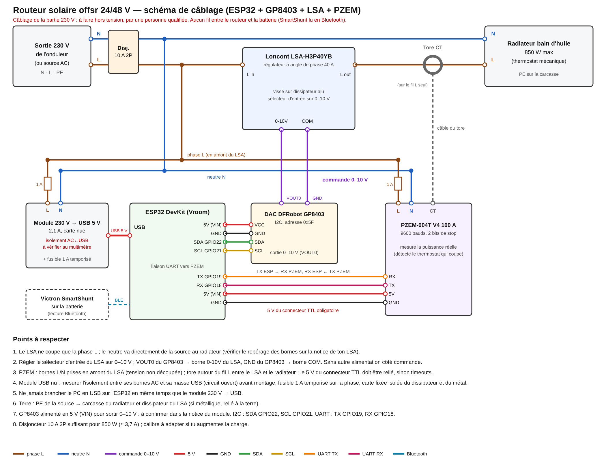
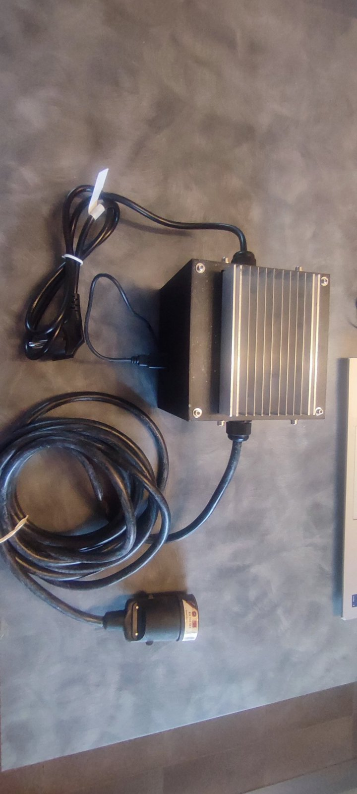
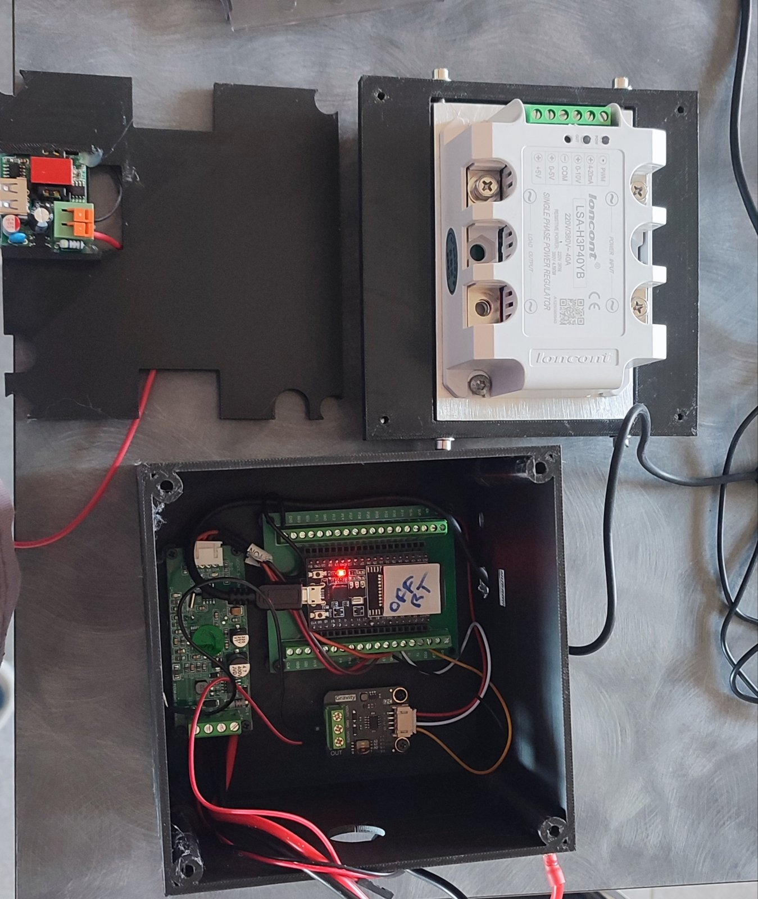

# offsr 24 / 48 V — routeur solaire off-grid (composant de SeByDocKy, patché)

Patch minimal du composant ESPHome `offsr` de [SeByDocKy/myESPhome](https://github.com/SeByDocKy/myESPhome)
pour l'utiliser avec une **batterie 24 V ou 48 V** (flag `battery_nominal`).

| Dossier | Contenu |
|---|---|
| [`esphome/`](esphome/README.md) | **À utiliser tel quel** : composant `offsr` déjà patché + YAML complet + mode d'emploi |
| `patches/offsr-24-48v.patch` | le patch seul, appliqué sur le commit `12fb7b5` de Seby |
| `apply.sh` | clone Seby, applique le patch, produit `build/components/offsr` |
| [`boitier3d/`](boitier3d/README.md) | boîtier imprimé en 3D (OpenSCAD) |

> Tout le mérite du composant revient à SeByDocKy. Voir la section *Licence* sur la provenance du code.

## Pourquoi un patch

Dans le composant d'origine, les seuils de tension batterie sont **bornés en dur** pour un pack ~48 V
(pas modifiables par substitutions yaml) :

| Entité | Bornes d'origine | Défaut d'origine | Bornes patchées | Défaut patché (`battery_nominal: 24`) |
|---|---|---|---|---|
| `starting_battery_voltage` | 45–60 V | 53.0 V | 20–64 V | 27.0 V |
| `charged_battery_voltage` | 50–60 V | 55.8 V | 20–64 V | 28.0 V |
| `discharged_battery_voltage` | 45–60 V | 55.6 V | 20–64 V | 27.6 V |

Sur un 24 V, les curseurs ne peuvent donc pas descendre sous 45 V. Le patch élargit les bornes à 20–64 V
(les deux tensions tiennent sur le même curseur) et choisit les défauts avec le flag `battery_nominal` (voir plus bas).
Les bornes sont dans `components/offsr/number/__init__.py`, les défauts C++ dans `components/offsr/offsr.h`.

Les consignes en ampères (`charging/absorbing/floating_setpoint`) ne sont pas liées à la tension et ne sont pas modifiées.

### Flag 24 V / 48 V (`battery_nominal`)

Le patch ajoute une option au composant `offsr`, sans changer le comportement par défaut (48 V = valeurs d'origine de Seby) :

```yaml
substitutions:
  battery_nominal: "24"      # "24" ou "48"

offsr:
  - id: my_offsr1
    # ...
    battery_nominal: ${battery_nominal}
```

| `battery_nominal` | `starting` | `charged` | `discharged` |
|---|---|---|---|
| `48` (défaut) | 53.0 V | 55.8 V | 55.6 V |
| `24` | 27.0 V | 28.0 V | 27.6 V |

**Piège :** ce flag ne fixe que les valeurs **par défaut**. Si les seuils ont déjà été sauvegardés en flash par le routeur
(première utilisation, ou réglage fait depuis l'interface web), cette valeur sauvegardée reste prioritaire. Après un
changement de flag, ressaisis une fois les trois seuils dans l'interface web (ou efface la flash).

### Multiplicateur de gains (`coeff_multiplier`)

Depuis le 25/10/2026, Seby ajoute dans `offsr` un sélecteur `coeff_multiplier` (10 / 1 / 0.1 / 0.01, défaut 1) qui multiplie
les trois gains `kp`, `ki` et `kd`. Il est inclus dans la version amont utilisée ici ; l'exemple yaml l'expose
(`select:`). Il sert à adapter les gains à la vitesse de la boucle sans retoucher le rapport entre `kp`, `ki` et `kd`.
Un multiplicateur de 10 accélère la montée **dix fois** : à n'essayer que par petits pas sur une batterie fragile.

### Choix des seuils pour un gel 24 V

- `starting` : 27.0 V. Une batterie pleine au repos est à ~25.8 V ; à 27.0 V le chargeur travaille réellement.
- `discharged` : 27.6 V (floating d'un gel 24 V, 13.8 V × 2).
- `charged` : tension d'absorption du chargeur − 0.2 V (28.0 V pour une absorption à 28.2 V).
- Un seuil `charged` trop bas fait voler au routeur le courant de fin de charge : l'absorption n'est jamais terminée, ce qui use vite un gel.
- Si ton chargeur compense en température, son absorption monte en hiver (~−48 mV/°C en 24 V) : revois `charged` à la hausse.

**Les défauts 24 V sont des points de départ prudents, pas des valeurs validées.** Ils sont à régler
selon la chimie et l'état de ta batterie (le test a été fait avec un pack gel de plus de 10 ans) :
mesure la tension au repos de ton pack avant de t'y fier.

## Utilisation

```bash
git clone https://github.com/SeByDocKy/myESPhome.git
cd myESPhome
git checkout 12fb7b5   # version amont sur laquelle le patch a été testé (25/10/2026)
patch -p1 < /chemin/vers/patches/offsr-24-48v.patch
```

ou `./apply.sh` depuis ce dépôt (clone Seby figé sur le commit `12fb7b5`, patch, résultat dans `build/components/offsr`).
`UPSTREAM_REF=main ./apply.sh` essaie la dernière version de Seby ; si le patch ne s'applique plus, c'est que `offsr` a changé en amont.

Puis copie `components/offsr/` à côté de ton yaml ESPHome et déclare-le en local :

```yaml
external_components:
  - source:
      type: local
      path: components
    components: [offsr]
  - source: "github://SeByDocKy/myESPhome/"
    components: [gp8403]
    refresh: 0s
```

Un yaml complet d'exemple est dans `esphome/offroutsr-24-48v-standalone.yaml`
(tout se règle dans les `substitutions:` en tête, sans `secrets.yaml` : voir [`esphome/README.md`](esphome/README.md)).
Version ESPHome testée : 2026.9.1.

## Schéma de câblage et photos



Schéma vectoriel : [`docs/schema-cablage.svg`](docs/schema-cablage.svg). Bornes du LSA à vérifier sur la notice de ton exemplaire ;
le câblage 230 V se fait hors tension.

| Boîtier fermé | Boîtier ouvert |
|---|---|
|  |  |

*Fermé* : dissipateur du LSA en face avant, câbles d'entrée et de sortie. *Ouvert* : ESP32 sur platine à bornes, DAC GP8403,
PZEM nu, module 230 V → USB fixé sur la plaque de séparation, LSA-H3P40YB sur son dissipateur.

## Matériel testé

ESP32 DevKit (esp32dev) · DFRobot Gravity GP8403/GP8413 (DAC I2C 0-10 V) · Loncont LSA-H3P40YB
(SSR à commande analogique 0-10 V) · PZEM-004T V4.0 (TTL) · SmartShunt Victron lu **en Bluetooth**
(`esphome-victron_ble`) au lieu de l'UART.
Écran OLED 0,96" 128×64 I2C (marquage JMD0.96C, SSD1306 probable, adresse 0x3C) · dissipateur aluminium 110 × 75 mm
pour le LSA (détails dans [`esphome/README.md`](esphome/README.md)).

## Retours d'expérience (banc de test)

- **Adresse I2C du GP8403** : mon module Gravity apparaît à `0x5F`, pas à `0x58`. Lance un scan I2C
  (`i2c: scan: true`) ; sinon : `not acked` à chaque écriture et sortie à 0.
- **`output_min` / `output_max` / `output_restart`** sont de simples valeurs de départ (0.18 / 0.85 / 0.4 dans `offsr.h`),
  réglables 0–1 et mémorisées en flash. La zone morte de conduction dépend du LSA et de la charge : à mesurer.
- **PZEM** : deux liaisons distinctes —  le 220 V sur ses bornes L/N (il s'alimente et mesure la tension par là),
  et la liaison TTL. Sur la TTL : **TX ESP32 → RX PZEM, RX ESP32 → TX PZEM**, et **le 5 V du connecteur TTL doit être
  câblé** : sans lui, le Modbus renvoie des octets aléatoires (`0x80`, `0x00`…) puis des timeouts.
  Le PZEM se place côté **entrée** du LSA (avant le découpage), comme sur les schémas de Seby.
- `power_mini` (seuil de détection de coupure thermostat) est fixé à 2 W dans `offsr.cpp`.

## Limites / non testé

- Pas encore validé sur batterie 24 V réelle ni sur la charge finale (ballon 1200 W) ; PID (kp/ki/kd) réglé sur
  ampoule / radiateur bain d'huile.
- Détection `thermostat_cut` non testée encore


## Licence

MIT, sur l'ensemble du dépôt :

- le patch, le YAML, la documentation et le boîtier 3D : MIT, Copyright (c) 2026 patmtp35 (fichier `LICENSE`) ;
- le composant `esphome/components/offsr/` (code de SeByDocKy, copie du commit `12fb7b5` + patch) : MIT, Copyright (c) 2026 e-2-nomy
  (fichier `esphome/components/offsr/LICENSE`, repris du dépôt amont [myESPhome](https://github.com/SeByDocKy/myESPhome),
  qui a ajouté sa licence MIT le 28/10/2026).

## Commande manuelle de la puissance

`manual_override` ne force pas une marche : il gèle la régulation (offsr n'écrit plus la sortie). Pour piloter la puissance à la main, l'exemple déclare un `fan` (platform `speed`) branché sur la même sortie, comme le suggère le code d'origine de SeByDocKy (bloc `fan:` commenté).

1. `manual_override` ON, `activation` ON.
2. Régler le curseur `manual_power` (0-100 %).
3. Retour en auto : curseur à 0 / OFF, puis `manual_override` OFF.

Attention : en manuel, plus aucune protection batterie n'agit, et le curseur ne doit pas être utilisé hors `manual_override` (deux écritures sur la même sortie).
