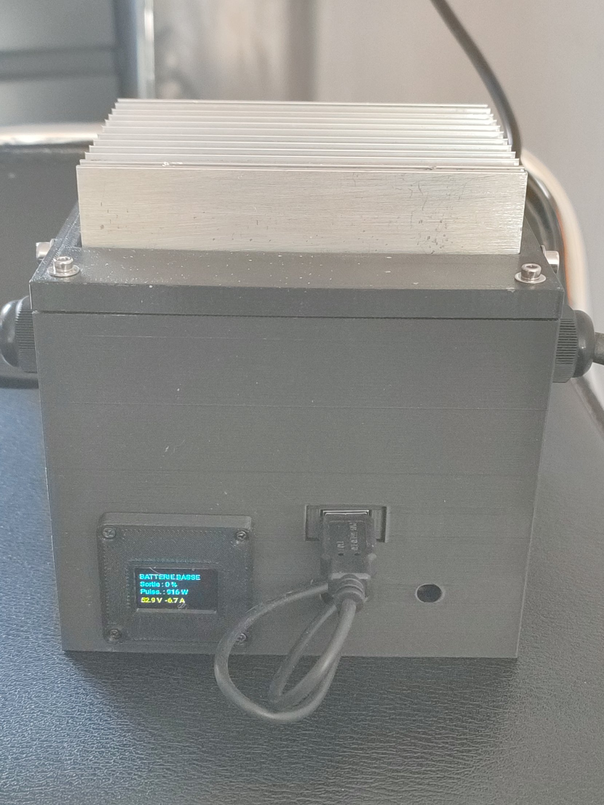

# Boîtier 3D du routeur solaire offsr

Boîtier imprimé en 3D (Creality Ender 3 V3 KE, PETG) pour le routeur solaire : LSA-H3P40YB sur son dissipateur,
Gravity GP8403, PZEM-004T-100A, ESP32 sur adaptateur à bornes, et module 230 V → 5 V USB.

Fichier : `boitier_routeur_solaire.scad` (OpenSCAD). Choisir la pièce avec `part` :
`"boite"`, `"couvercle"`, `"plaque"` (sortie retournée, prête à imprimer), `"support_oled"`, `"gabarit_oled"` ou `"ensemble"` (aperçu éclaté).

## Principe

- Deux niveaux séparés par une plaque amovible : basse tension en bas (ESP32, Gravity, PZEM), 230 V en haut.
- Le LSA est fixé retourné sous le couvercle, le dissipateur dépasse par une lucarne ; les vis M4 du couvercle entrent dans les canaux du dissipateur.
- Câbles 230 V par deux presse-étoupes PG13.5 sur les parois ±Y ; alimentation 5 V et antenne par la paroi +X.
- Les encoches de la plaque sont ouvertes sur le bord : on soulève la plaque sans rien débrancher.
- Le module USB 230 V → 5 V (carte nue) se glisse sous la plaque ; sa prise USB est en face d'une fenêtre de la paroi +X, au-dessus du trou d'alimentation de l'ESP32.

## Écran OLED 0,96" (module JMD0.96C, I2C)

Support imprimé à part (`support_oled`), vissé à l'extérieur de la paroi +X par 4 vis M2 de 8 mm dans des inserts à chaud M2.
Le gabarit (`gabarit_oled`) sert à percer les 4 trous des inserts et à repérer le trou de 14 × 6 mm pour le connecteur et les Dupont.
Cotes du module : circuit 28,6 × 27,15 mm, épaisseur 4 mm avec le verre, zone visible 23,4 × 15,5 mm. Testé : le support convient.
La boîte prévoit les 4 trous d'inserts et le trou des Dupont (`oled_on`, position `oled_y` / `oled_z`).
Emplacement conseillé : à gauche du trou d'alimentation vu de l'extérieur, centre à environ 39 mm de l'axe de ce trou et 28 mm du bas.

## Impression (PETG, pas de PLA)

0,2 mm, 3 parois, remplissage gyroïde 30 % (couvercle : 4 parois, 40 %), buse 235 °C, plateau 75 °C, sans supports.

## État

- Le fichier n'a pas été compilé automatiquement : faire F6 sur chaque pièce dans OpenSCAD.
- Couvercle : imprimé et validé. Boîte : à réimprimer avec la nouvelle disposition et la fenêtre USB. Plaque : à réimprimer avec les glissières.
- À mesurer : `gland_above` (hauteur d'entrée de fil des bornes du LSA), épaisseur du PCB du module USB (`usb_pcb_t`), hauteur de sa prise (`usb_h`), hauteur maximale de l'adaptateur ESP32.
- Carte du module USB : 36,77 × 30,80 mm, avec une partie avant plus étroite (33,63 mm sur 5,77 mm) qui sert de butée dans les glissières.

## Sécurité

La carte 230 V → 5 V est nue : vérifier son isolation (circuit ouvert entre les bornes AC et le GND de l'USB, hors tension), mettre un fusible 1 A temporisé sur la phase, ne jamais brancher un PC sur l'ESP32 pendant qu'il est alimenté par ce module.
